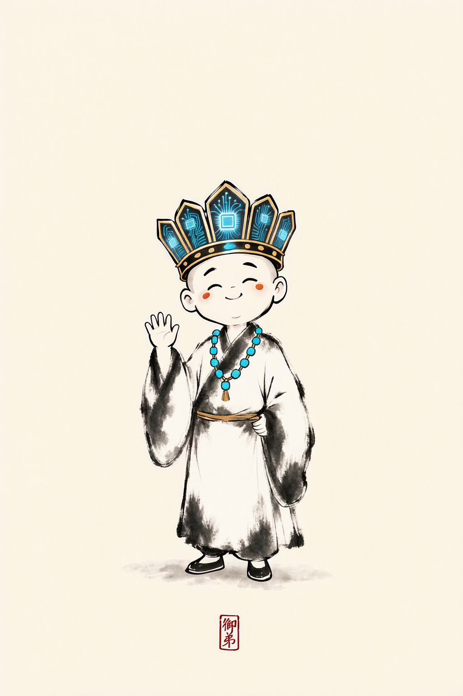

# yudi-cover

「御弟悟AI」公众号封面生成 Skill。把御弟 IP 形象和暖纸枯笔水墨画风锁成一套可复用的提示词与检查清单，每期只换主标题、系列名和一个动作场景。

适用于支持 Skill / 自定义指令的 Agent（如 Qoder、Claude Code）。出图依赖支持参考图的图片生成工具。

## 输出示例





## 特点

- **形象锁定**：清瘦小和尚御弟，五叶电路毗卢帽、白袍墨染衣领、芯片念珠，出图必带形象参考。
- **画风锁定**：FE-061 当代人文水墨漫画，暖纸底、枯笔飞白、远景山水与墨竹。
- **文案分层**：大字数主标题 + 朱红小楷系列名（可省）+ 阴文印章，层次固定不串味。
- **一次一改**：附验收清单和迭代纪律，避免越改越漂。

## 安装

```bash
git clone https://github.com/yudiwuai/yudi-cover.git ~/.qoder/skills/yudi-cover
```

目录名保持 `yudi-cover`，Agent 才能按名字加载。

## 使用

对 Agent 说「给这篇文章出个封面」，并给出：

1. 主标题（必填，8–14 字为宜）
2. 系列名（可选，例如「本地模型能做什么」）
3. 本期场景或文章主题（Agent 会先想一个画面隐喻）

默认输出 21:9、2560×1080 的公众号头图；需要 1:1 方形版时追加一句「方形版」即可。

## 目录

```
yudi-cover/
├── SKILL.md              # 技能说明、prompt 模板、验收清单
└── assets/
    ├── character-ref.png # 御弟形象硬参考
    └── style-ref.png     # FE-061 画风基准
```

## 版权

「御弟」角色形象与示例图片版权归作者所有。`SKILL.md` 中的流程和提示词可自由参考学习，转载或商业使用请先联系作者。
